# Fourdiff: A new way to resolve merge conflicts with ease and confidence

Hi, my name is Noam. I'm the original creator of [tqdm](https://github.com/tqdm/tqdm/commits/master/?author=noamraph), the Python progress bar library, so I can say that I have had at least one good idea. I want to share with you something that I have been using for the past 8 years: a new way to resolve merge conflicts (as well as cherry-pick and revert conflicts), that I call FourDiff.

A few years ago I was trying to resolve a particularly horrible merge conflict, and as a way to escape the horror, I started thinking: could there be a better way? A way that would let me really understand what I'm doing, instead of trying to guess my way out of the mess? Thank God, I found such a way, and I've been using it ever since. In fact, I can now barely resolve merge conflicts without it.

Here's a simple example. If you run this:

```bash
git clone https://github.com/noamraph/conflict-example.git
cd conflict-example
git merge origin/add-imports
```

You'll get this merge conflict (in `file.py`):

```python
import os
import sys
import json
<<<<<<< HEAD
=======
import random
import datetime
import math
import time
import collections
>>>>>>> origin/add-imports
import pathlib
import urllib
```

Seems easy enough. This is how it looks in VSCode:

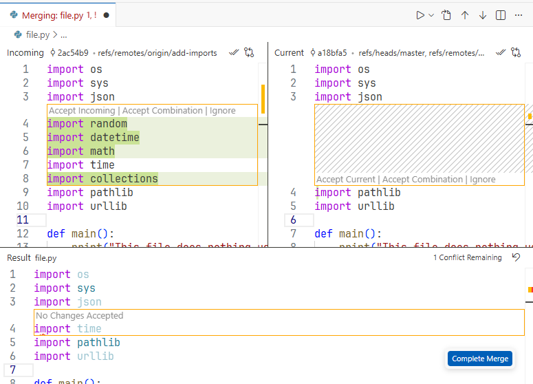

If you stop to think about it, there's something strange: why is `import time` not highlighted on the left? Anyway, I'm pretty sure I would have just taken all the imports and be done with it. However, that wouldn't be correct. Here's how it looks with Meld in FourDiff mode:

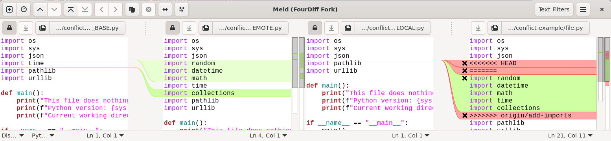

If you want to see it for yourself, follow the instructions in [Installation](#installation), and run:

```bash
git mergetool -t fourdiff
```

(You need to add `-t fourdiff` only if you haven't set it as your default merge tool.)

There are 4 panes. From left to right:

1. BASE
2. REMOTE
3. LOCAL
4. MERGED

LOCAL is your file before the merge. MERGED is the file you edit, where you want to resolve the conflict. Now, here's the crucial part: resolving the conflict **doesn't** mean to somehow combine REMOTE and LOCAL. What it **does** mean is to apply the change between BASE and REMOTE onto LOCAL. I like looking at it like adding vectors:


To get to MERGED, we need to add the blue vector, that takes us from BASE to REMOTE, onto LOCAL.

We can write:

* MERGED = LOCAL + (REMOTE - BASE)

Or:

* MERGED - LOCAL = REMOTE - BASE

Anyway, from looking at the two leftmost panes, it's clear what change we want to apply: add the imports for `random`, `datetime`, `math` and `collections`. But what actually is the source of this conflict? To see the source of the conflict, we can press Ctrl-T, or click the  button. The view switches to showing only the diff between the BASE and LOCAL panes. This diff is the orange arrow in the diagram, and it's the cause of the merge conflict - it's why it's not trivial to apply the change between BASE and REMOTE onto LOCAL. Here's how it looks:

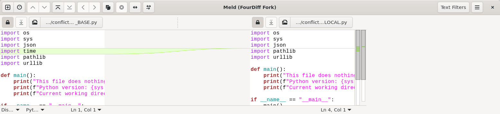

So we see that the change between BASE and LOCAL, which we still want to preserve, is simply removing the `import time` line. Fortunately, the change we want to apply didn't touch `import time`, so we can press Ctrl-T again and edit the right pane to get this:

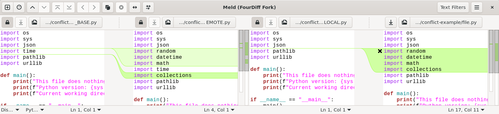

Now it's quite easy to see, visually, that the diff between BASE and REMOTE is now the same diff as between LOCAL and MERGED. So we're done!

One more thing: Another way to get to MERGED is by adding the diff between BASE and LOCAL onto REMOTE, rather than by adding the diff between BASE and REMOTE onto LOCAL. Visually:


In some cases it can be much easier to apply this other change. To get this, click the  button ("swap REMOTE and LOCAL"), and you'll get:

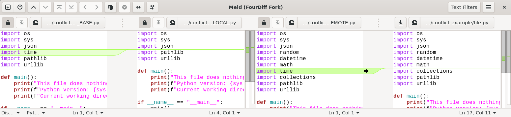

All this did was swap between LOCAL and REMOTE, the two middle panes. The MERGED pane is exactly the same. In this case, now it's even simpler to see that we applied the diff correctly: in both cases, the change is simply to delete the `import time` line.

## A more complex example

<details>
<summary>
If you'd like to see a more complex merge conflict example I ran into at work, click here.
</summary>
<hr/>

Here's a real world example. I just changed some names to avoid giving away state secrets. You can get it by merging a different branch in the same `conflict-example` repository:

```bash
git clone https://github.com/noamraph/conflict-example.git
cd conflict-example
git merge origin/test-add-env
```

Here's how it looks in vscode:

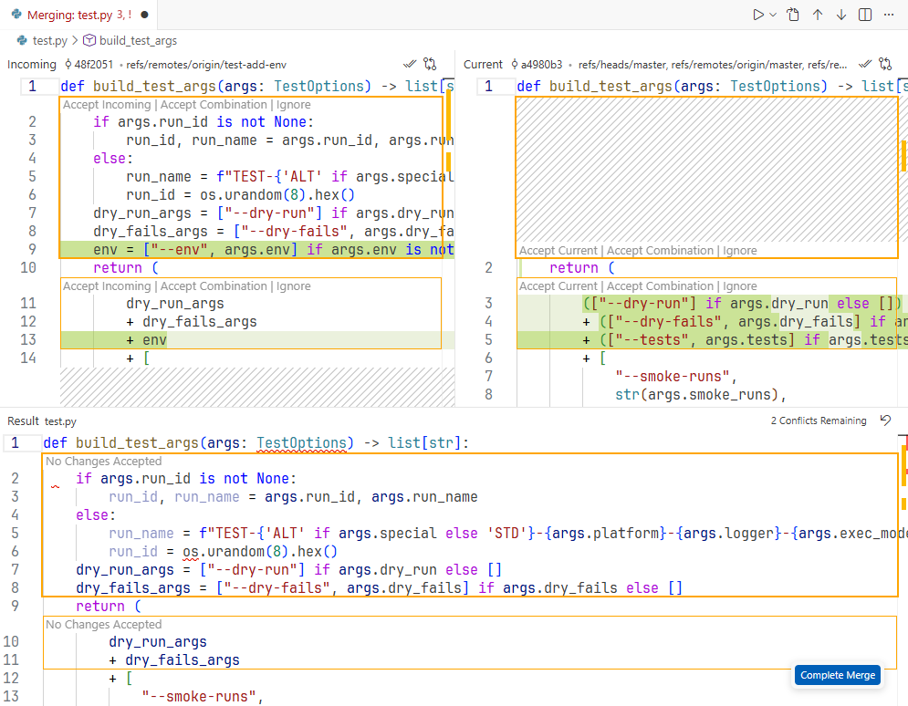

Good luck with that!

Here's how it looks after you run `git mergetool -t fourdiff`:

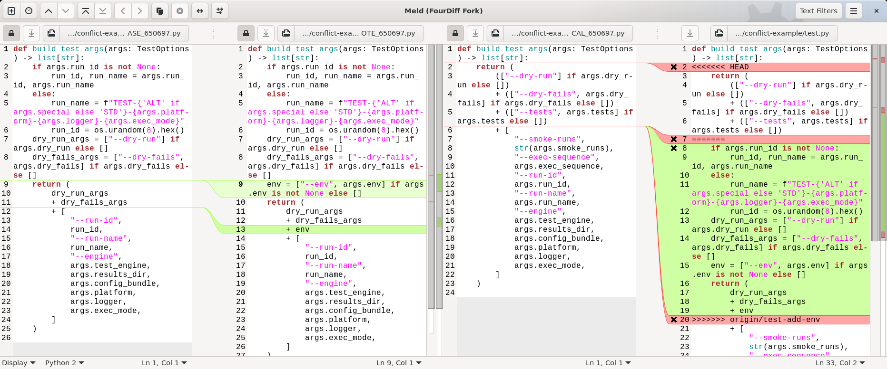

We see that the change we want to apply (between BASE and REMOTE) is just the addition of `env` after `dry_fails_args`. All the items in this list are lists of command-line arguments. The added `env` is defined to be:

```python
env = ["--env", args.env] if args.env is not None else []
```

Now we can press Ctrl-T, and see the difference between BASE and LOCAL, which caused the conflict:

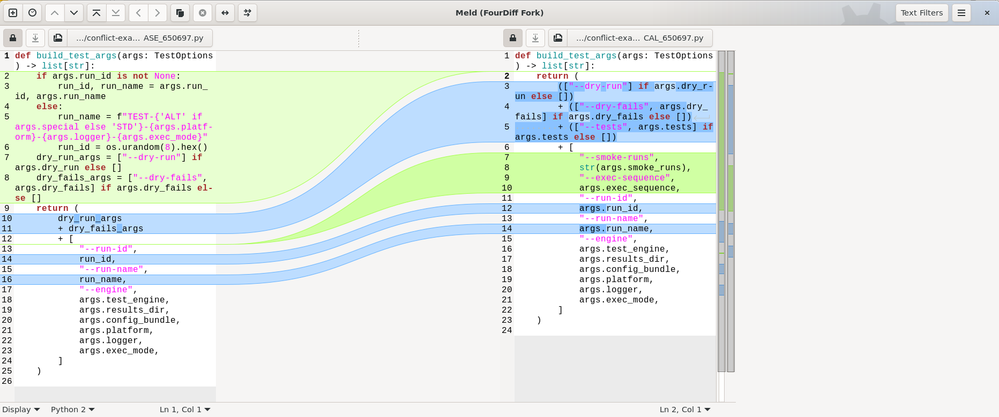

We see that the function actually got shorter. We can see that the changes are:
1. Instead of first defining `dry_run_args` and `dry_fails_args` and referencing it, it was decided to put the expressions directly in the `return` statement.
2. Two new argument parts were added, `--smoke-runs` and `--exec-sequence`.
3. `run_id` and `run_name` are now given in `args` instead of computed in the function.

Now it's quite easy to apply the change: We should just add the `--env` argument list. Let's add it after `--dry-fails`, like in the original change. We get:

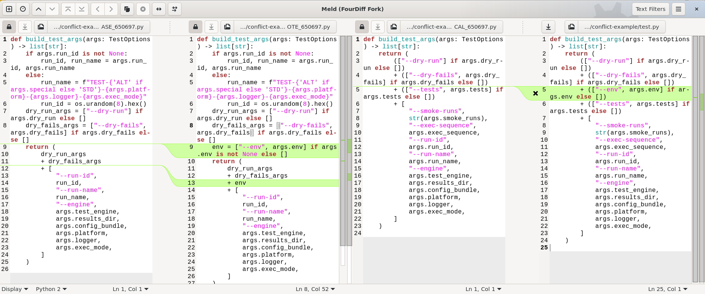

What I like in this view is that it lets me see in one picture how I applied the change on top of the modified code, and I can review it and gain confidence that the resolution makes sense.

</details>

## Installation

Install Meld, for example by running:

```bash
uv tool install meldmerge
```

Add Meld, in its FourDiff mode, as a merge tool:

```bash
git config --global mergetool.fourdiff.cmd 'meld "$BASE" "$REMOTE" "$LOCAL" "$MERGED"'
```

Optionally, make it the default merge tool:

```bash
git config --global merge.tool fourdiff
```
